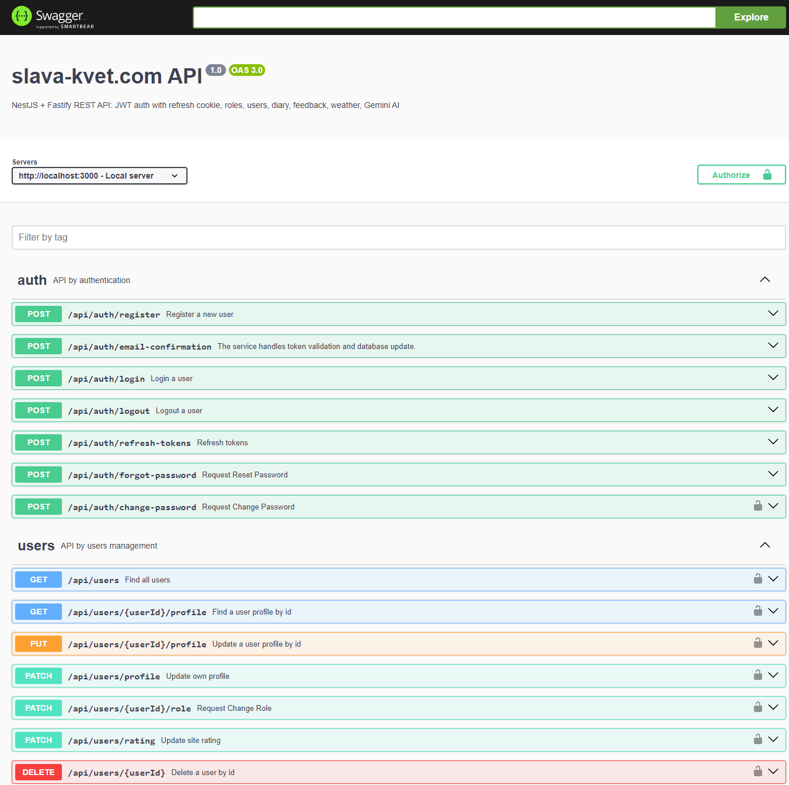
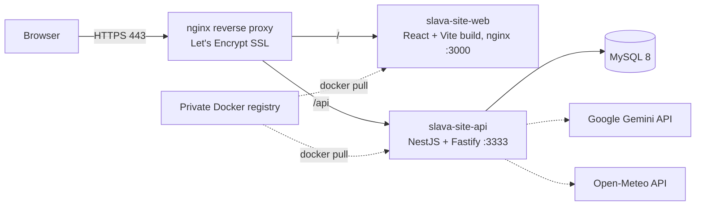

# slava-site-api — backend of slava-kvet.com

The REST API behind my personal portfolio site (Sep – Dec 2025), built with **NestJS on Fastify**,
TypeORM and MySQL. Interactive API documentation is generated with Swagger.



## What it does

- **Authentication & authorization** (`src/iam`) — register, email confirmation, login, logout,
  forgot/change password; JWT access token + **refresh token in an HttpOnly cookie**;
  passwords hashed with **argon2**; role-based guards (admin / customer).
- **Users** — list, profile, change role, site rating, delete (admin only; user #1 is protected).
- **Diary**, **Feedback** — per-user data stored as MySQL / JSON.
- **Weather** — table and chart data from the Open-Meteo API.
- **Ask from…** — AI feature using the **Google Gemini API**.
- **Download** — file streaming endpoint.
- **Security & robustness** — Helmet, CORS, rate limiting, under-pressure health protection,
  request validation with class-validator.
- **Mail** — nodemailer (confirmation and password-reset emails).
- **Tests** — 14 unit spec files and 6 e2e suites (Jest + Supertest): register, login, users,
  forgot/change password.

## Tech stack

Node.js · NestJS · Fastify · TypeScript · TypeORM · MySQL 8 · JWT · argon2 · Swagger (OpenAPI 3) ·
nodemailer · Google Gemini · Jest · Docker

## Architecture



## Run locally

```bash
# MySQL (from slava-site-infra: schema + demo data)
docker run -d --name slava-mysql -p 3306:3306 -e MYSQL_ROOT_PASSWORD=root \
  -v "$(pwd)/../slava-site-infra/mysql/migration:/docker-entrypoint-initdb.d" mysql:8

pnpm install
cp .env.example .env      # NODE_ENV=development, DB settings, SWAGGER_USER / SWAGGER_PASSWORD
pnpm run start:dev        # API on http://localhost:3333, Swagger on http://localhost:3333/docs
pnpm test                 # unit tests
pnpm run test:e2e         # end-to-end tests
```

Gemini and email are optional for a local run; those endpoints just won't work without keys.

## Related repositories

| Repo | What it is |
|---|---|
| [slava-site-web](https://github.com/israelrider/slava-site-web) | Frontend: React + TypeScript |
| [slava-site-api](https://github.com/israelrider/slava-site-api) | Backend: NestJS REST API |
| [slava-site-infra](https://github.com/israelrider/slava-site-infra) | Infrastructure: Docker Compose, nginx, registry, MySQL |

---

## Developer notes (original)

`pnpm install`

`cp .env.example .env`

`docker build -t backend .`

### Config settings .env

`
   EMAIL_HOST=smtp.mailtrap.io
   EMAIL_PORT=2525
   EMAIL_AUTH_USER=[:user]
   EMAIL_AUTH_PASSWORD=[:password]
   EMAIL_DEBUG=true
   EMAIL_LOGGER=true
`
### Config settings .env for TypeORM MySQL Database
Once the database has been configured, start the Nest App via `pnpm run start:dev` it automatically synchronizes the entities so it is ready to use.

`
   TYPEORM_CONNECTION = "mysql"
   TYPEORM_HOST = "localhost"
   TYPEORM_PORT = 3306
   TYPEORM_USERNAME = [:user]
   TYPEORM_PASSWORD = [:password]
   TYPEORM_DATABASE = [:database]
   TYPEORM_AUTO_SCHEMA_SYNC = true
   TYPEORM_ENTITIES = "dist/**/*.entity.js"
   TYPEORM_SUBSCRIBERS = "dist/subscriber/**/*.js"
   TYPEORM_MIGRATIONS = "dist/migrations/**/*.js"
   TYPEORM_ENTITIES_DIR = "src/entity"
   TYPEORM_MIGRATIONS_DIR = "src/migration"
   TYPEORM_SUBSCRIBERS_DIR = "src/subscriber"
`

```sql
CREATE DATABASE IF NOT EXISTS `slava_server`
DEFAULT CHARACTER SET utf8mb4
DEFAULT COLLATE utf8mb4_0900_ai_ci;
```

### Install TypeScript Node

` pnpm install -g ts-node `

## Running migrations with typeorm

`   ts-node node_modules/.bin/typeorm migration:run -d dist/typeorm-cli.config `

or

`   node_modules/.bin/typeorm migration:run -d dist/typeorm-cli.config `

`
    # development
    $ pnpm dev

    # watch mode
    $ pnpm start:dev

    # production mode
    $ pnpm start:prod
`

### Docker

There is a `docker-compose.yml` file for starting MySQL with Docker.

`$ docker-compose up db`

After running, you can stop the Docker container with

`$ docker-compose down`

### Url Swagger for Api Documentation

` http://127.0.0.1:3000/docs `

or

` http://127.0.0.1:3000/docs-json `

or

` http://127.0.0.1:3000/docs-yaml `

Configure `SWAGGER_USER` and `SWAGGER_PASSWORD` in the .env file for to access the Swagger(Open API) documentation with basic authentication. `NODE_ENV`
must not be equal to "production" otherwise the Swagger is not displayed.

`
NODE_ENV=[:enviroments]
SWAGGER_USER=[:user]
SWAGGER_PASSWORD=[:password]
`
### Configuring the SERVER_PORT environment variable as the default port if you don't want to use the default

`   SERVER_PORT=3333 `

### Configuring the ENDPOINT_URL_CORS environment variable for app frontend

` ENDPOINT_URL_CORS='http://127.0.0.1:4200' `
